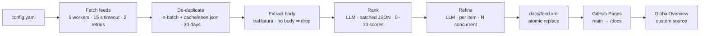

<div align="center">

# FeedOverview

**Many RSS sources in. One calm, curated, AI-condensed feed out.**

A zero-server aggregator that fetches your sources, extracts the real article body, ranks everything
against your interests, condenses the winners, and publishes a single RSS 2.0 file from GitHub
Pages — ready to be added to [GlobalOverview](#subscribe-from-globaloverview) as a custom source.

[](#quick-start)
[](#tests)
[](#output-format)
[](#environment-variables)
[](#deploy-github-actions--github-pages)

<p>
  <a href="#why-it-exists">Why</a> ·
  <a href="#how-it-works">How it works</a> ·
  <a href="#quick-start">Quick start</a> ·
  <a href="#configuration">Configuration</a> ·
  <a href="#deploy-github-actions--github-pages">Deploy</a> ·
  <a href="#subscribe-from-globaloverview">GlobalOverview</a> ·
  <a href="#cost-model-and-cost-control">Cost</a> ·
  <a href="#resilience">Resilience</a> ·
  <a href="#tests">Tests</a> ·
  <a href="#troubleshooting">Troubleshooting</a>
</p>

</div>

---

## Why it exists

Feeds are cheap; attention is not. Nine book blogs produce ~30 posts a day, most of them listicles,
reposts, or teasers whose "content" is a headline plus a link.

FeedOverview does the boring part of reading for you:

- **Real article bodies.** Pages are fetched and parsed with trafilatura, so entries carry text, not
  a one-line teaser. If a body cannot be extracted, the entry is dropped rather than published as a
  summary stub.
- **Ranked against *your* interest profile**, not an editor's. One LLM call per batch, with reasons.
- **Condensed, not rewritten.** A second pass trims each selected article to ~800 characters while
  keeping facts, figures and quotes. Titles stay untouched by default.
- **Never the same link twice.** A committed `cache/seen.json` gives incremental de-duplication for
  30 days, across runs.
- **Nothing can take the feed down.** A dead source, a blocked page, a broken model response — each
  failure has a defined fallback, and `docs/feed.xml` is always valid.

No database. No server. No client changes. One workflow file and one YAML file.

## At a glance

| Item | Detail |
| --- | --- |
| **Input** | Any number of RSS/Atom feeds (`config.yaml`) |
| **Output** | One RSS 2.0 file at `docs/feed.xml`, served by GitHub Pages |
| **Schedule** | Every 6 hours (`workflow_dispatch` also supported) |
| **Runtime** | ~40 s for 9 sources / 10 candidates / 5 items (measured, `glm-4-flash`) |
| **Dependencies** | `feedparser`, `feedgen`, `requests`, `trafilatura`, `openai`, `PyYAML`, `python-dateutil` |
| **Cost** | 0 with a free model; ~US$4–6/month at `gpt-4o-mini`-class pricing ([details](#cost-model-and-cost-control)) |
| **Secrets** | `LLM_API_KEY` only (plus optional `LLM_BASE_URL`, `LLM_MODEL`) |

---

## How it works



Four guarantees are built into that chain:

| Stage | If it fails | Result |
| --- | --- | --- |
| Feed fetch | Source skipped, others continue | Partial run, still publishes |
| Body extraction | Article dropped (no summary stub), link stays unseen | Retried next run |
| Ranking | Time + source-weight ordering | Feed still ordered sensibly |
| Refinement | That item keeps its truncated original body | Feed still complete |

Steps in code:

| # | Function | What happens |
| --- | --- | --- |
| 1 | `fetch_all()` | ThreadPoolExecutor(5), 15 s timeout, 2 retries, browser-like UA |
| 2 | `dedupe_articles()` | Normalized link (tracking params, fragments, trailing slashes removed) |
| 3 | `select_for_llm()` | Pre-filter to `max_candidates_for_llm` by time, then source weight |
| 4 | `enrich_all()` | trafilatura extraction, body capped at `extract.max_content_chars` |
| 5 | `rank_articles()` | Batched prompts → `{"order":[{"index","score","reason"}]}` |
| 6 | `refine_articles()` | One call per item with `llm.refine.concurrency` workers |
| 7 | `write_feed()` | feedgen → temp file → `os.replace` |

### Output format

| Field | Content |
| --- | --- |
| `title` | Original title, or the model's title when `refine.keep_title: false` |
| `link` / `guid` | Original article URL (permalink) |
| `pubDate` | Publication time from the source feed |
| `source` | Source display name (with the feed URL) |
| `description` | HTML: AI label, ranking reason, condensed body, source/time, original link |

Every description starts with **`【AI 精简版】`** and ends with the original link — the only
authoritative version of the article.

---

## Repository layout

```
config.yaml                  sources, interest profile, LLM settings
requirements.txt             runtime dependencies
src/
  main.py                    pipeline entry point (python -m src.main)
  config.py                  defaults, YAML merge, env overrides, validation
  http.py                    single HTTP helper: timeout, retries, User-Agent
  feedfetch.py               RSS/Atom download and entry parsing
  content.py                 trafilatura extraction; bodyless articles are dropped
  textutil.py                URL normalization, HTML stripping, truncation, XML sanitizing
  dedup.py                   batch dedupe + persistent SeenStore
  llm.py                     OpenAI-compatible client, retries, robust JSON parsing
  rank.py                    LLM ranking, batching, fallback ordering
  refine.py                  per-article condensation with per-item fallback
  feedbuild.py               RSS 2.0 generation via feedgen
docs/
  feed.xml                   generated feed (committed by the workflow)
  index.html                 tiny landing page
cache/
  seen.json                  generated seen-link cache (committed by the workflow)
tests/                       pytest suite, fully offline
.github/workflows/aggregate.yml
```

---

## Quick start

```bash
git clone https://github.com/<you>/FeedOverview.git
cd FeedOverview

python -m venv .venv
# Windows: .venv\Scripts\activate
source .venv/bin/activate

pip install -r requirements.txt
pip install pytest            # only needed for the tests

python -m src.main            # writes docs/feed.xml and cache/seen.json
python -m pytest              # 134 offline tests
```

No key? Still works — ranking degrades to "newest first + source weight" and refinement is skipped,
but `docs/feed.xml` is produced. That is the fastest way to validate feed configuration before
spending tokens.

```bash
python -m src.main --config config.yaml --log-level DEBUG
# or
FEED_CONFIG=config.yaml LOG_LEVEL=DEBUG python -m src.main
```

Requirements: Python 3.11+ (developed on 3.14.3, CI on 3.11).

---

## Configuration

Every key is optional and falls back to the defaults in `src/config.py`; `config.yaml` ships with a
working example.

### Feed-level

| Key | Default | Meaning |
| --- | --- | --- |
| `feed_title` | `Curated Tech Feed` | Channel title |
| `feed_link` | `https://example.com/` | Public Pages URL (update this) |
| `feed_description` | – | Channel description |
| `feed_language` | `en` | Channel language code |
| `output_path` | `docs/feed.xml` | Where the feed is written |
| `seen_path` | `cache/seen.json` | Persistent seen-link cache |
| `seen_retention_days` | `30` | Age after which seen links are pruned |
| `max_items` | `50` | Items in the final feed |
| `max_items_per_source` | `20` | Candidates taken from one source per run |
| `max_candidates_for_llm` | `80` | Candidates that reach extraction + ranking |
| `interest` | `""` | Reader interest description used in the ranking prompt |

### `feeds`

| Key | Meaning |
| --- | --- |
| `name` | Display name, used in `source` and the ranking prompt (alias: `title`) |
| `url` | RSS/Atom URL |
| `weight` | Optional float (default `1.0`); used for pre-filtering and fallback ordering only |

Feed lists exported from other tools (`{ title, url, category }`) can be pasted in unchanged;
`category` is ignored.

### `extract`

| Key | Default | Meaning |
| --- | --- | --- |
| `timeout` | `15` | Seconds per HTTP request |
| `retries` | `2` | Retries after the first failure (3 attempts total) |
| `max_workers` | `5` | Concurrent downloads |
| `user_agent` | browser-like | Sent on every request |
| `fast` | `true` | trafilatura: skip slow fallback extractors |
| `favor_recall` | `true` | trafilatura: prefer recall over precision |
| `max_content_chars` | `8000` | Body characters kept per article |
| `min_content_chars` | `80` | Below this, extraction counts as failed → article dropped |

### `llm`

| Key | Default | Meaning |
| --- | --- | --- |
| `model` | `gpt-4o-mini` | Model name; `LLM_MODEL` overrides it |
| `temperature` | `0.2` | Sampling temperature |
| `max_summary_chars` | `1200` | Body preview length inside the ranking prompt |
| `ranking_criteria` | built-in | Free-form ranking rubric |
| `rank_batch_size` | `40` | Articles per ranking request |
| `timeout` | `90` | Seconds per LLM request (`config.yaml` uses 120) |
| `extra_body` | `{}` | Extra request fields forwarded as-is, e.g. `{"thinking":{"type":"disabled"}}` |

### `llm.refine`

| Key | Default | Meaning |
| --- | --- | --- |
| `enabled` | `true` | Master switch for the condensation pass |
| `max_input_chars` | `4000` | Body characters sent to the model |
| `max_output_chars` | `800` | Target and hard cap for the condensed body |
| `concurrency` | `3` | Parallel refinement requests |
| `style` | built-in | Editing instructions injected into the prompt |
| `keep_title` | `true` | When true the model only condenses the body |

Prompts are English by default, but the rubric and the style are configuration values — switch the
output language entirely by editing `llm.ranking_criteria` and `llm.refine.style`.

---

## Environment variables

| Variable | Required | Meaning |
| --- | --- | --- |
| `LLM_API_KEY` | no | API key for any OpenAI-compatible endpoint. Missing ⇒ degraded mode |
| `LLM_BASE_URL` | no | e.g. `https://api.openai.com/v1`, `https://open.bigmodel.cn/api/paas/v4` |
| `LLM_MODEL` | no | Overrides `llm.model` |
| `FEED_CONFIG` | no | Alternative path to `config.yaml` |
| `LOG_LEVEL` | no | `DEBUG`, `INFO` (default), `WARNING`, `ERROR` |

Credentials come from the environment only — never from `config.yaml` — so nothing secret ends up in
the repository.

### Provider notes: Zhipu BigModel (智谱 GLM)

Verified end to end against the 15-source set in `config.yaml` (news, science, tech, books, ideas,
learner, business, life): 20 candidates, 16 with extractable bodies, 10 published in ~75 s.

```bash
LLM_BASE_URL="https://open.bigmodel.cn/api/paas/v4"
LLM_MODEL="glm-4-flash"          # free tier, recommended
```

```yaml
llm:
  model: "glm-4-flash"
  timeout: 120
  extra_body:                # only needed for GLM-4.5; harmless for glm-4-flash
    thinking:
      type: disabled
  refine:
    concurrency: 3
```

| Model | Ranking (10 items) | 5 refinements | Notes |
| --- | --- | --- | --- |
| `glm-4-flash` | ~15 s | ~10 s at concurrency 3 | fastest, most stable; 10/10 items scored |
| `glm-4.5-flash`, thinking off | ~37 s | ~98 s at concurrency 1 | richer reasons, ~6× slower |
| `glm-4.5-flash`, default | 66 s+ | ~45 s per item | reasoning pass on; hits the 90 s default timeout |
| `glm-4.7-flash` | – | – | newest free tier but heavily loaded, frequent `429 / 1305` |

Two gotchas that cost real time if you skip them:

- **Thinking mode (GLM-4.5 only).** A ranking call took ~66 s with reasoning on and ~7 s with
  `extra_body` disabling it. `glm-4-flash` has no reasoning pass, so the field is ignored.
- **Concurrency.** `glm-4-flash` handled 3 simultaneous calls fine. `glm-4.5-flash` returns
  `429 / code 1302` as soon as two refinement calls overlap — use `refine.concurrency: 1` there.
  Either way the built-in 429 backoff keeps the run alive, and a throttled item simply keeps its
  original body.

---

## Deploy: GitHub Actions + GitHub Pages

1. **Push to GitHub** (public or private; Pages on a private repo may need a paid plan).
2. **Add secrets** — *Settings → Secrets and variables → Actions*:
   `LLM_API_KEY` (required for ranking + refinement), optional `LLM_BASE_URL`, `LLM_MODEL`.
3. **Enable Pages** — *Settings → Pages → Deploy from a branch → `main` / `/docs`*.
   The site becomes `https://<user>.github.io/FeedOverview/`.
4. **Point `feed_link`** in `config.yaml` at that URL (it is only a channel link, but it should not
   lie).
5. **Run once** — *Actions → Aggregate feeds → Run workflow*. The job commits `docs/feed.xml` and
   `cache/seen.json`; Pages publishes within a minute.

The workflow runs every 6 hours (`0 */6 * * *`) plus manual dispatch, requests
`permissions: contents: write`, uses a `concurrency: aggregate-feeds` group so runs queue instead of
racing, and has a 40-minute timeout. It commits only `docs/` and `cache/`, and exits quietly when
nothing changed. Pages redeploys on every push — no extra deploy action needed.

---

## Subscribe from GlobalOverview

GlobalOverview's client code is not touched; this repository is just a feed producer.

1. Open `https://<user>.github.io/FeedOverview/feed.xml` and confirm it renders as XML.
2. In GlobalOverview choose **Add source → Custom / Manual RSS**.
3. Paste the URL, name it (e.g. `FeedOverview`), save.

The document is plain RSS 2.0 with `title`, `link`, `description`, `pubDate`,
`guid isPermaLink="true"` and `<source>` — everything a standard reader expects.

If the reader shows nothing, `curl -I <url>` should return `200` and an XML content type; Pages
serves XML correctly out of the box.

---

## Cost model and cost control

Ranking is cheap: `ceil(candidates / rank_batch_size)` calls per run, each with a short body preview.
**Refinement dominates** — one call per published item.

On a free model (e.g. `glm-4-flash`) the token cost is zero and the real budget becomes throughput
([provider notes](#provider-notes-zhipu-bigmodel-智谱-glm)).

Estimates for the defaults (`max_items: 50`, `max_input_chars: 4000`, `max_output_chars: 800`, 4 runs
per day):

| Stage | Calls per run | Input tokens | Output tokens |
| --- | --- | --- | --- |
| Ranking | ≈ 2 batches | ~15k total | ~1k total |
| Refinement | 50 | ~50 × 2–3k ≈ 120k | 50 × ~500 ≈ 25k |

At `gpt-4o-mini`-class pricing that is roughly **US$0.03–0.05 per run, ≈ US$4–6 per month**.
Levers, cheapest first:

- `llm.refine.max_input_chars` — halving it roughly halves refinement input cost.
- `max_items` — fewer items, fewer refinement calls (linear).
- `llm.refine.max_output_chars` — smaller output cap, fewer output tokens.
- `llm.refine.enabled: false` — drop refinement entirely; only ranking is billed.
- `max_candidates_for_llm` — smaller ranking prompts.
- The cron expression — e.g. `0 */12 * * *` halves the number of runs.

`docs/feed.xml` is produced whatever the budget is.

---

## Resilience

| Failure | Behaviour |
| --- | --- |
| One source unreachable / 404 / malformed | Logged, source skipped, others continue |
| Page download fails or returns 403 | Article dropped, never published as a summary stub |
| trafilatura returns `None` or short text | Article dropped, never published as a summary stub |
| No `LLM_API_KEY`, client cannot be created | Ranking falls back to newest-first + weight, refinement skipped |
| Ranking call fails or returns invalid JSON | That batch is ordered by time; the run continues |
| All ranking batches fail | Whole run uses the fallback ordering |
| One refinement call fails or returns invalid JSON | That item keeps its truncated original body, stays in the feed |
| Provider throttles the account (`429` / `1302`) | Backoff, one retry, then per-item fallback |
| `cache/seen.json` corrupt or missing | Warning, cache starts empty, links re-evaluated |
| No new articles | Valid feed with zero items is written, URL always resolves |
| Fatal crash anywhere else | Traceback logged, exit code 1, previous `docs/feed.xml` untouched |

The feed is replaced atomically (temp file + `os.replace`), so readers never see a half-written
document. Control characters that are illegal in XML are stripped before writing, rather than
crashing the run.

---

## Tests

```bash
python -m pytest          # 134 tests, no network, no API key
```

| Area | File |
| --- | --- |
| URL normalization, truncation, HTML stripping | `tests/test_textutil.py` |
| In-batch dedupe, seen-cache roundtrip, 30-day pruning, corrupt cache | `tests/test_dedup.py` |
| Fallback ordering, batching, pre-filter | `tests/test_rank.py` |
| Extraction → drop, download failure, exception, truncation | `tests/test_content.py` |
| Per-item refinement fallback, invalid JSON, title handling, output cap | `tests/test_refine.py` |
| RSS structure, AI label, original link, empty feed, escaping | `tests/test_feed.py` |
| LLM client availability, tolerant JSON parsing, `extra_body` | `tests/test_llm.py` |
| HTTP retries, timeouts, 404/429/5xx handling | `tests/test_http.py` |
| Feed parsing: relative links, missing title/link, HTML page, empty body | `tests/test_feedfetch.py` |
| Config defaults, `title` alias, coercion, invalid YAML | `tests/test_config.py` |
| XML-illegal characters, emoji, odd URLs, malformed LLM output | `tests/test_edge_cases.py` |
| Full pipeline without credentials, idempotent second run | `tests/test_main.py` |

---

## Design notes and assumptions

Judgement calls made where the original brief was ambiguous or contradicted itself:

1. **Python version.** The brief mentions 3.14.3 locally but asks CI for 3.11. CI pins `3.11`; the
   code runs on 3.11–3.14. Change `python-version` in the workflow to `3.14.3` if you prefer.
2. **Pre-filter before extraction.** Downloading thousands of pages just to discard them is
   wasteful, so candidates are trimmed to `max_candidates_for_llm` by time + weight *before*
   extraction. Ranking still batches, so short lists behave identically.
3. **Extraction failure means removal, not a stub.** The original brief asked for an RSS-summary
   fallback; that was explicitly overruled — a summary is a teaser, not an article body. Dropped
   links are *not* written to `cache/seen.json`, so a transient block can recover next run.
4. **Everything that survives extraction is marked seen.** This keeps the bill predictable and
   guarantees no duplicate links; the trade-off is that a low-ranked article will not resurface.
5. **`fast=True` vs `no_fallback`.** Newer trafilatura renamed the argument, so `extract_text()`
   tries `fast=` first and retries with `no_fallback=` on `TypeError`.
6. **Fallback body length.** On refinement failure the item keeps its original body truncated to
   `max_input_chars` (not `max_output_chars`), so the reader still gets the full context.
7. **Label when refinement is off.** The description still starts with `【AI 精简版】` and explains
   in parentheses that the body is an excerpt because refinement was skipped or failed.
8. **Refined output validation.** A `refined` value shorter than 20 characters, or a non-string, is
   treated as failure and replaced by the original body.
9. **Short articles are not refined.** Bodies under 80 characters pass through unchanged.
10. **`feeds[].weight`** affects pre-filtering and fallback ordering only — a deliberate degradation
    path, not a hidden signal in the LLM prompt.
11. **`docs/feed.xml` placeholder.** A valid empty feed is committed so the Pages URL works before
    the first workflow run.
12. **Hostile text is sanitised before XML.** `sanitize_xml()` removes only what XML 1.0 forbids;
    emoji, accents and CJK survive. Root-relative entry links are resolved against the feed URL.
13. **Entries are emitted in ranked order.** feedgen prepends new entries by default, which silently
    reversed the ranking in the XML; `add_entry(order="append")` keeps best-first order. Ranking
    runs at `temperature=0`, because the same candidates otherwise drift between runs on small
    models.

---

## Troubleshooting

**The feed is empty after a run.**
If the log says `Dropped N of M articles without an extractable body`, every source blocked the
crawler or is JS-rendered — nothing is published by design. Otherwise look for
`No new articles after de-duplication`: nothing new, or everything already published. Delete
`cache/seen.json` to force a rebuild.

**Many articles disappear between runs.**
Extraction failed for them. They are dropped (not summarised) and not marked seen, so they are
retried next run. If this repeats, the site blocks automated requests or renders client-side: keep
`extract.favor_recall: true`, use a more realistic `user_agent`, or drop that source.

**The run is slow.**
Each dead source costs up to `(retries + 1) × timeout` seconds; article downloads add more. Lower
`extract.timeout` or remove flaky feeds.

**Ranking looks random.**
Without `LLM_API_KEY` the order is "newest first, then source weight" by design. Check for
`LLM unavailable` in the log.

**The log shows `429` or error code `1302`.**
The provider is throttling concurrency: set `llm.refine.concurrency: 1`, keep thinking disabled, and
optionally lower `max_items`. Failed items still ship with their original body.

**Every LLM call takes 30 s or more.**
Usually a reasoning/thinking mode. For GLM-4.5 add `extra_body: {thinking: {type: disabled}}`; for
other providers check their equivalent switch.

**Pages shows a 404 for `/feed.xml`.**
Pages is probably set to `/(root)` instead of `/docs`, or the branch is not `main`.

**A push from the workflow is rejected.**
Another run committed first. The `concurrency` group makes this rare; re-run the workflow and the
`git pull --rebase` step reconciles.

---

<div align="center">

**FeedOverview** — built to be forgettable in the best way: it just keeps the feed fresh.

<sub>RSS 2.0 · GitHub Actions · GitHub Pages · trafilatura · any OpenAI-compatible model</sub>

</div>
